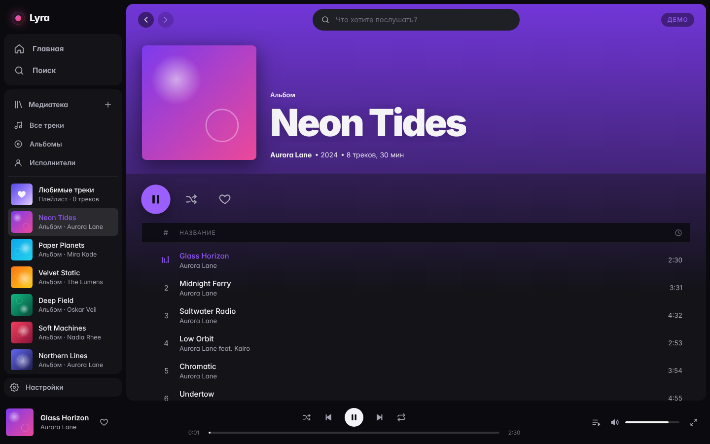

# Lyra

Локальный музыкальный плеер в духе Spotify — красивый, но лёгкий.
Без Electron: **Tauri 2 + Rust** вместо встроенного Chromium и Node.js.



## Почему он лёгкий

| | Spotify (Electron/CEF) | Lyra |
|---|---|---|
| Движок интерфейса | собственный Chromium внутри приложения | системный WebView (WebKitGTK / WebView2 / WKWebView) |
| Бэкенд | Node.js / C++ | Rust, один процесс |
| Звук | через браузерный движок | нативно: Rust → symphonia → звуковая карта |
| Размер бинарника | ~150–300 МБ | **~6 МБ** (Linux, release) |
| CPU в простое | заметный | **≈0 %** — интерфейс ничего не перерисовывает без событий |

Что ещё сделано ради экономии ресурсов:

- **Звук не идёт через WebView.** Декодирование и вывод — в отдельном Rust-потоке (rodio + symphonia).
  Интерфейс получает только позицию 4 раза в секунду и только во время проигрывания.
- **Виртуализированный список треков**: в DOM всегда ~40 строк, даже если в медиатеке 50 000 треков.
- **Обложки уменьшаются до 512 px** при сканировании и кэшируются на диске — WebView не декодирует
  мегабайтные сканы. Карточки за пределами экрана не отрисовываются (`content-visibility`).
- **Инкрементальное сканирование**: неизменённые файлы (по mtime) не перечитываются; сканирование параллельное (rayon).
- Фронтенд на **Svelte 5** — компилируется в обычный JS без виртуального DOM, весь бандл ~40 КБ gzip.

## Возможности

- Главная, «Все треки», альбомы, исполнители, любимые треки, поиск с «лучшим результатом» и жанрами
- Интерфейс подстраивает акцентный цвет под обложку текущего трека
- Полноэкранный режим «Сейчас играет» с размытой обложкой на фоне
- Очередь: «играть следующим», «добавить в очередь», удаление, перемешивание, повтор (очередь / трек)
- Контекстное меню по правому клику, горячие клавиши, кнопки мыши «назад/вперёд»
- Восстановление сессии: очередь и позиция сохраняются, после перезапуска можно продолжить с того же места
- Теги и обложки читаются из файлов (lofty), либо обложка берётся из `cover.jpg` / `folder.png` рядом с треками
- Форматы: MP3, FLAC, OGG Vorbis, M4A/AAC, ALAC, WAV, AIFF

### Горячие клавиши

| Клавиши | Действие |
|---|---|
| `Пробел` | играть / пауза |
| `Ctrl + →` / `Ctrl + ←` | следующий / предыдущий трек |
| `→` / `←` | перемотка ±5 с |
| `Ctrl + ↑` / `Ctrl + ↓` | громкость |
| `M` | выключить звук |
| `Ctrl + K` или `/` | поиск |
| `Alt + ←` / `Alt + →` | назад / вперёд |

## Запуск

Нужны [Rust](https://rustup.rs), Node.js 20+ и pnpm, а также системные зависимости Tauri
([инструкция](https://v2.tauri.app/start/prerequisites/)). Для Debian/Ubuntu:

```sh
sudo apt install libwebkit2gtk-4.1-dev libasound2-dev librsvg2-dev libssl-dev
```

```sh
pnpm install
pnpm tauri dev      # режим разработки
pnpm tauri build    # установщик / пакет в src-tauri/target/release/bundle
```

Интерфейс можно открыть и в обычном браузере (`pnpm dev` → http://localhost:1420) — без Tauri он
работает на демо-данных. Удобно для правок дизайна.

Сборки для Windows, macOS и Linux собирает GitHub Actions (`.github/workflows/build.yml`) при пуше тега `v*`.

## Структура

```
src-tauri/src/
  library.rs   сканирование папок, теги, кэш обложек, цвет обложки
  player.rs    поток воспроизведения (rodio/symphonia), события прогресса
  lib.rs       команды Tauri
src/
  lib/store.svelte.ts   состояние: медиатека, очередь, плеер, лайки, навигация
  components/           сайдбар, плеер, список треков, очередь, полноэкранный режим
  views/                страницы
```

## Тесты

```sh
cd src-tauri
cargo test                                            # базовые тесты
LYRA_TEST_MUSIC=~/Music cargo test scans_folder -- --nocapture   # сканирование реальной папки
LYRA_TEST_AUDIO=~/Music/song.flac cargo test plays_and_seeks     # воспроизведение и перемотка
```

## Что можно добавить дальше

- Медиаклавиши и интеграция с системой (MPRIS / SMTC) через `souvlaki`
- Gapless-воспроизведение с предзагрузкой следующего трека
- Плейлисты, счётчик прослушиваний, тексты песен (`.lrc`)
- Отслеживание изменений в папках (`notify`) вместо пересканирования
